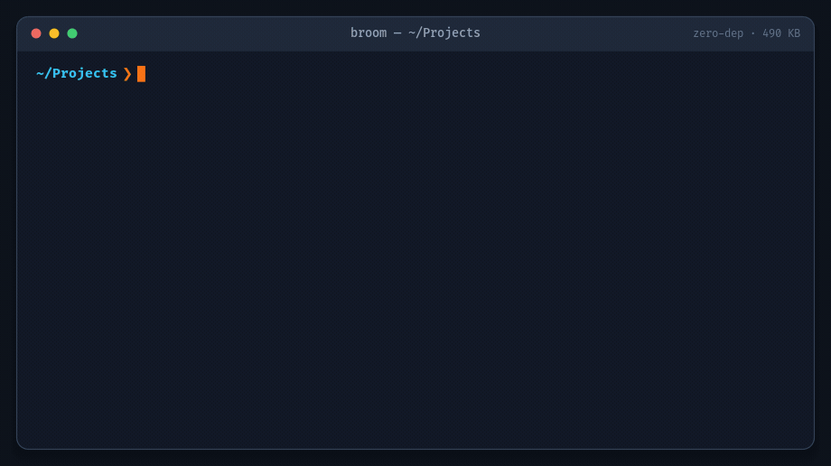

<div align="center">
  
  <h1>broom</h1>
  <p><strong>Blazing-fast, zero-dependency Rust CLI to find and sweep stale build artifacts and dev caches.</strong></p>

  <p>
    <a href="https://github.com/Kolgrim33/broom/actions/workflows/ci.yml"></a>
    <a href="LICENSE"></a>
    
    
  </p>

  <p>
    <a href="#install">Install</a> •
    <a href="#usage">Usage</a> •
    <a href="#supported-ecosystems">Ecosystems</a> •
    <a href="#contributing">Contributing</a>
  </p>
</div>

<p align="center">
  
</p>

---

Reclaim tens of gigabytes of forgotten `target/`, `node_modules/`, `.venv/`, `build/`, `.next/`, and `.zig-cache/` directories across all your repositories in milliseconds — without deleting anything you still need.

## Why `broom`?

- **Zero runtime dependencies:** Pure Rust `std` — compiles in ~1 second and ships as a tiny `~490 KB` static binary.
- **Fast parallel scanner:** Multi-threaded directory walker with POSIX block-size accounting and hardlink deduplication (matches `du`).
- **Marker-verified safety:** Never blindly deletes a folder named `target` or `build`. Verifies parent project markers (`Cargo.toml`, `package.json`, `build.gradle`, etc.) *and* inner markers (`CMakeCache.txt`, `pyvenv.cfg`), ignores symlinks, and defaults to **No** at the prompt.
- **Project-aware age:** Tracks when the *project* was last touched (source files + `.git/index`), so `-a 30d` sweeps forgotten repos while keeping active builds warm.
- **Zero-friction CLI UX:** Sweep everything (`y`), cherry-pick rows inline (`1,3-5`), step one-by-one (`i`), preview safely (`-n`), or pipe `--json` to scripts.

## Supported Ecosystems

| Ecosystem | Project Marker | Cleaned Artifacts |
| --- | --- | --- |
| **Rust** | `Cargo.toml` | `target` |
| **Node / JS / TS** | `package.json` | `node_modules`, `.next`, `.nuxt`, `.svelte-kit`, `.astro`, `.turbo`, `.parcel-cache`, `.angular`, `.expo`, `.nx`, `.output`, `.vite` |
| **Python** | `pyproject.toml`, `requirements.txt`, `setup.py`, `*.py` | `.venv` / `venv` *(requires `pyvenv.cfg`)*, `__pycache__`, `.pytest_cache`, `.mypy_cache`, `.ruff_cache`, `.tox`, `.nox`, `.hypothesis` |
| **Gradle** | `build.gradle(.kts)`, `settings.gradle(.kts)` | `build`, `.gradle` |
| **Maven** | `pom.xml` | `target` |
| **CMake** | `CMakeLists.txt` | `build`, `_build`, `cmake-build-debug`, `cmake-build-release`, `cmake-build-relwithdebinfo`, `cmake-build-minsizerel` *(requires `CMakeCache.txt`)* |
| **Meson** | `meson.build` | `build`, `builddir`, `_build` *(requires `meson-private`)* |
| **Zig** | `build.zig` | `.zig-cache`, `zig-cache`, `zig-out` |
| **Swift** | `Package.swift` | `.build` |
| **CocoaPods** | `Podfile` | `Pods` *(requires `Manifest.lock`)* |
| **Elixir** | `mix.exs` | `_build`, `deps` |
| **Erlang / Rebar3** | `rebar.config` | `_build` |
| **Gleam** | `gleam.toml` | `build` |
| **.NET** | `*.csproj`, `*.fsproj`, `*.vbproj` | `bin`, `obj` |
| **Dart / Flutter** | `pubspec.yaml` | `.dart_tool`, `build` |
| **Scala / sbt** | `build.sbt`, `*.sbt` | `target`, `.bloop`, `.metals` |
| **Clojure** | `project.clj`, `deps.edn`, `shadow-cljs.edn` | `target`, `.cpcache`, `.shadow-cljs` |
| **Haskell** | `cabal.project`, `*.cabal`, `stack.yaml` | `dist-newstyle`, `.stack-work` |
| **OCaml / Dune** | `dune-project`, `dune-workspace`, `*.opam` | `_build`, `_opam` *(requires `.opam-switch`)* |
| **PHP / Composer** | `composer.json`, `phpunit.xml(.dist)` | `vendor` *(requires `autoload.php`)*, `.phpunit.cache` |
| **Ruby** | `Gemfile`, `*.gemspec` | `.ruby-lsp`, `.yardoc` |
| **Godot** | `project.godot` | `.godot`, `.import` |
| **Unity** | `ProjectSettings/ProjectVersion.txt` | `Library`, `Temp`, `Obj`, `Logs` |
| **Unreal Engine** | `*.uproject` | `Intermediate`, `DerivedDataCache` |
| **Terraform / OpenTofu** | `*.tf`, `*.tofu` | `.terraform` |
| **Bazel** | `WORKSPACE`, `WORKSPACE.bazel`, `MODULE.bazel` | `bazel-bin`, `bazel-out` |

*Missing your favorite language or build tool? Adding an ecosystem takes ~15 lines — see [CONTRIBUTING.md](CONTRIBUTING.md)!*

## Install

### From source (Rust 1.85+)

```bash
cargo install --git https://github.com/Kolgrim33/broom
```

Or clone and install locally:

```bash
git clone https://github.com/Kolgrim33/broom.git
cd broom
cargo install --path .
```

## Usage

```bash
# Scan current directory and interactively decide what to sweep
broom

# Preview reclaimable space in ~/Projects without prompting
broom -n ~/Projects

# Find artifacts larger than 100MB in projects untouched for 30+ days
broom -a 30d -s 100M ~/Projects

# Sweep only Rust and Node artifacts without prompting
broom -t rust,node -y ~/Projects

# Sort oldest projects first, excluding a path pattern
broom --sort age -e work-critical ~/Projects

# Machine-readable JSON output for scripts
broom --json ~/Projects | jq '.artifacts[] | {path, size_human}'

# Find the top 25 largest individual files in ~/Downloads (preview or sweep interactively)
broom -f ~/Downloads

# Show the 10 largest files over 100MB anywhere in ~ without prompting
broom -f -n -s 100M --limit 10 ~
```

### Flags

| Flag | Description |
| --- | --- |
| `-f, --files` | Scan for the largest individual files instead of build artifacts |
| `-n, --dry-run` | Scan and print report only; do not prompt or delete |
| `-y, --yes` | Delete all matched artifacts/files without prompting |
| `-i, --interactive` | Prompt individually (`[y/N/a/q]`) for each item |
| `-a, --older-than <AGE>` | Only match projects/files untouched for at least `AGE` (`12h`, `7d`, `2w`, `3mo`, `1y`) |
| `-s, --min-size <SIZE>` | Only match items at least `SIZE` (`50M`, `1GiB`, `500K`) |
| `-t, --type <LIST>` | Filter by ecosystem (comma-separated, repeatable; artifact mode only) |
| `-e, --exclude <PATTERN>` | Exclude paths containing `PATTERN` (repeatable) |
| `-d, --max-depth <N>` | Maximum directory depth to scan |
| `--sort <FIELD>` | Sort by `size` (default), `age`, or `path` |
| `-r, --reverse` | Reverse sort order |
| `--limit <N>` | Show/operate on at most `N` results (defaults to `25` in `--files` mode) |
| `--hidden` | Descend into hidden directories (and include hidden files in `--files` mode) |
| `--json` | Emit JSON report (implies `--dry-run`) |
| `--no-color` | Disable colored output (also honors `NO_COLOR`) |
| `-j, --threads <N>` | Worker thread count (default: CPU cores) |

## Contributing

Contributions are very welcome! Check out [CONTRIBUTING.md](CONTRIBUTING.md) for guidelines and great first issues, including:

- Adding new ecosystems (Nim, V, Julia, LaTeX, etc.)
- `--trash` mode (move to FreeDesktop/macOS/Windows Trash instead of permanent delete)
- Global dev-cache scanning (`~/.cargo/registry`, `~/.gradle/caches`, `~/.npm`, `~/.cache/uv`, `GOCACHE`, `~/.cache/bazel`)
- Shell completions (`bash`, `zsh`, `fish`)

## License

[MIT](LICENSE)
